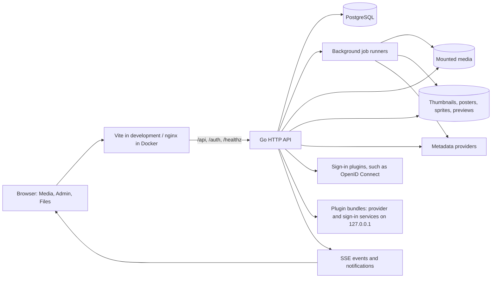
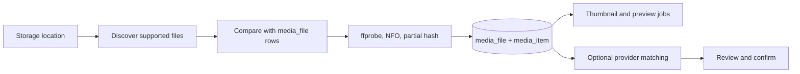

# Architecture

## System overview

The Go API runs as two servers built from one module, both wired by `backend/internal/server`:

| Server | Command | Image target | Serves | Runs |
| --- | --- | --- | --- | --- |
| media | `cmd/media-server` | `media` | Browsing, playback (direct, HLS), sign-in, per-user state. Admin-only routes are not registered. | Sign-in plugin bundles only. No jobs. |
| admin | `cmd/admin-server` | `admin` | The admin API and the reads the admin app needs. | Every background job, the scanner, schedules, file watching, downloads and all plugin bundles. |

`cmd/server` runs both halves in one process (`REELSTASH_ROLE=media` or `admin` picks one); local packages, SQLite installs and tests use it.

Both servers share one PostgreSQL database. Each applies the embedded migrations at start under an advisory lock, so they can start together. Work the media server asks for (sprites, previews) is written as a `PENDING` `background_job` row; the admin server picks such rows up every few seconds and claims each one atomically. Notifications and plugin changes cross between the servers over PostgreSQL `LISTEN/NOTIFY` (`internal/events/bridge.go`), so a scan that finds new titles reaches people connected to the media server, and the media server reloads its sign-in plugins when an admin changes them. Each server shuts down HTTP and workers gracefully on SIGTERM or Ctrl+C.

## Frontend and HTTP boundary

`media/` is the media library web app (`index.html`); `admin/` is the admin web app with three entries: `admin.html` for Admin, `files.html` for Files and `downloads.html` for Downloads. Each is its own project with its own image, and they share no source. The media app's nginx forwards `/api`, `/auth`, and `/healthz` to the media server; the admin app's nginx forwards them to the admin server. Both disable proxy buffering for server-sent events and direct media streams. Editing lives only in the admin app; the media app has no edit controls. Admin editors can be opened directly with `?edit=<id>` (`/admin/videos?edit=<id>`, `/admin/metadata/performers?edit=<id>` and so on).

Each app's `src/api.js` centralizes its API calls, and the backend contract test checks each against its own server's routes. `media/src/libraryContext.jsx` tracks the selected library. The Go router (`internal/httpapi/router.go`) is the route and authorization boundary; hiding an Admin link in React never grants or removes permissions.

## Backend packages

| Package | Responsibility |
| --- | --- |
| `httpapi` | Routes, request validation, authorization, streaming, and admin endpoints |
| `auth` | Password accounts, sessions, and identity state |
| `authplugin` | Client and registry for sign-in plugins |
| `plugins` | Installs plugin bundles and supervises their processes ([Plugin bundles](plugin-bundles.md)) |
| `database` | PostgreSQL pool and embedded migrations |
| `jobs` | Persisted queue, worker concurrency, cancellation, resumption |
| `scanner` | Filesystem discovery, probing, NFO import, hashes, thumbnails, sprites, previews, duplicates |
| `namer`, `provider`, `tmdb`, `titlematch` | Metadata matching, the provider interface, the built-in TMDB provider, and the title helpers ReelStash itself needs |
| `organizer`, `rename` | Rule-driven organization and file renaming |
| `events`, `notify` | SSE job updates, notifications, webhooks |
| `extprovider` | Adapts an external HTTP service to the provider interface (plugins) |
| `schedule` | Cron-driven scans and duplicate checks, and inotify file watching that triggers scans |
| `qbit`, `downloads` | qBittorrent WebUI client; the Downloads service that polls it, protects the in-progress folder and runs move rules ([Downloads](downloads.md)) |
| `pathguard` | Which paths scans, the watcher, organizer, housekeeping and Files must leave alone: locked folders and torrent data in use |
| `lang` | Normalises language tags so audio and subtitle tracks match a user's language preference |
| `recommend`, `diskinfo` | Recommendations and storage capacity data |

## Scan and matching flow

A scan is incremental: it discovers files, compares them with existing records, probes new or changed files, and updates database records. Thumbnail and related asset work uses a separate worker pool, so a long scan cannot occupy every thumbnail worker. Exact duplicate detection is a separate job because it must read full file contents. Scan progress is stored in `scan_job`; general job state is stored in `background_job`.

The `jobs` package persists pending work before queueing it. On startup, the runners resume pending jobs. On graceful shutdown, in-flight jobs are returned to pending so they can resume; a user cancellation is recorded as cancelled. The main worker pool runs scan, organizer, matching, and maintenance work; the thumbnail pool handles thumbnail, sprite, and preview generation.

## Automation

`schedule.Scheduler` wakes at the start of every minute and runs each enabled `scan_schedule` row whose cron expression matches, queueing the same `SCAN` or `DUPLICATE_SCAN` jobs an admin would. `schedule.Watcher` keeps one `fsnotify` watcher per storage location with `watch_enabled`, adds watches for new folders, ignores `.nfo` files (ReelStash writes those itself), and queues a scan once 45 seconds pass without a relevant change. Both go through `schedule.EnqueueScan`, which refuses a second scan of a disk that is scanning or being organized. Failures reuse the notification path of `jobs.SetFinishHook`; a schedule or watcher that cannot start raises an admin notification directly.

## Audio and subtitle tracks

`ffprobe` output is stored in `media_track` when a file is scanned, and `media_file.sidecar_subtitles` counts the subtitle files beside it. The `TRACK_SCAN` job (queued after every scan) reads the tracks of files that have none yet and recounts subtitle files for every video; files are otherwise filled in the first time their tracks are requested. `GET /api/media/{id}/tracks` adds sidecar subtitle files found next to the video. Text subtitles are served as WebVTT, converted with `ffmpeg` (or in Go for `.srt`) and cached. `?audio=N` selects an audio stream: a stream-copy remux for direct play, or `-map 0:a:N` in the HLS transcode, each cached separately.

## Data model

PostgreSQL is the source of truth. The consolidated schema script defines users, storage locations, media items and files, people, studios, series, tags, collections, playback state, duplicate groups, jobs, sessions, provider links, notifications, library roots and access, scan rules, and per-user favorites. `library_root` maps storage paths to libraries; `library_access` controls which libraries a user can browse.

Media files and generated assets are separate from database rows. Backups should include the database and asset volumes. The original media mount is managed separately and should be backed up according to its own storage policy. The consolidated PostgreSQL schema is embedded in the Go binary and applied at startup; an error stops startup.

## Authentication and authorization

Sign-in has four front doors that all end in the same server-side session, identified by an HTTP-only cookie: ReelStash's own username/password accounts (`/auth/native-login`, and `/auth/setup` for the first admin), sign-in plugins (`/auth/plugin/{id}/...`, plus any callback address a plugin declares, such as `/auth/callback`, and `/auth/login` for the first redirect plugin), and the optional emergency password. `/auth/config` tells the sign-in screen which are available; `/auth/logout` ends the session. Every `/api/*` request requires a session. Admin routes require an Admin role; library scope restricts media and file access. A selected library is sent through `X-Library` or `?library=` for direct browser URLs. The optional app or library PIN adds a lock layer.

See [HTTP API](api.md) for route groups and [Configuration](configuration.md) for auth settings.
